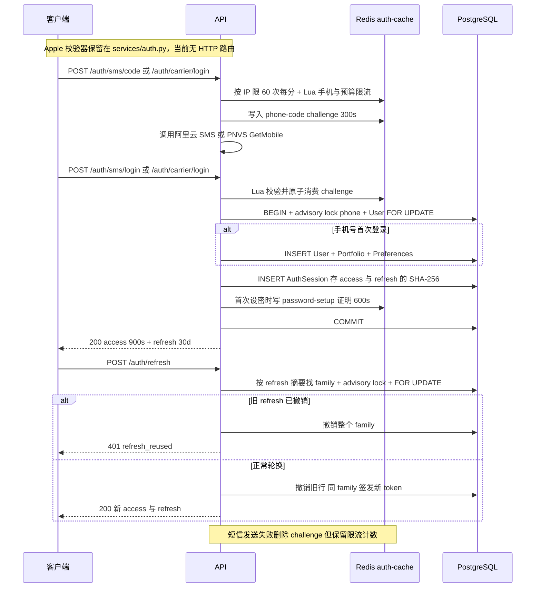
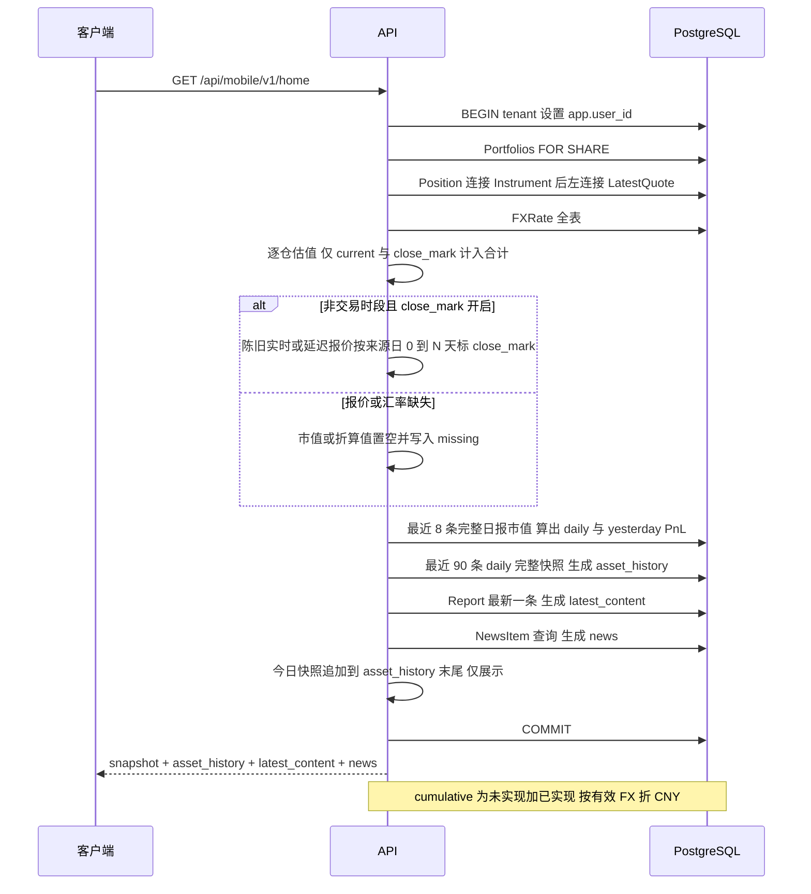
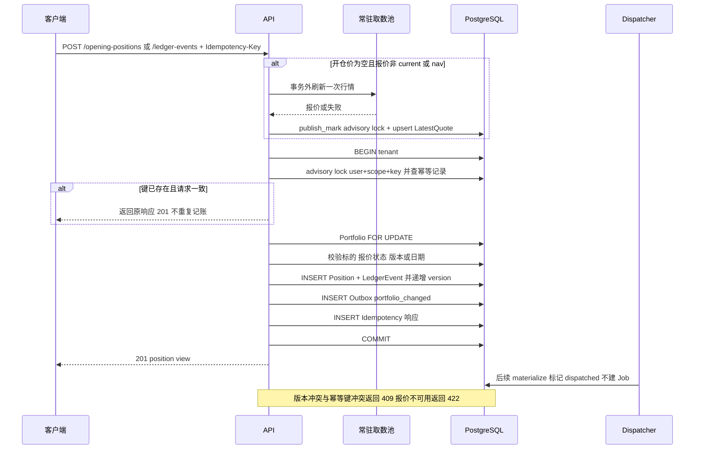
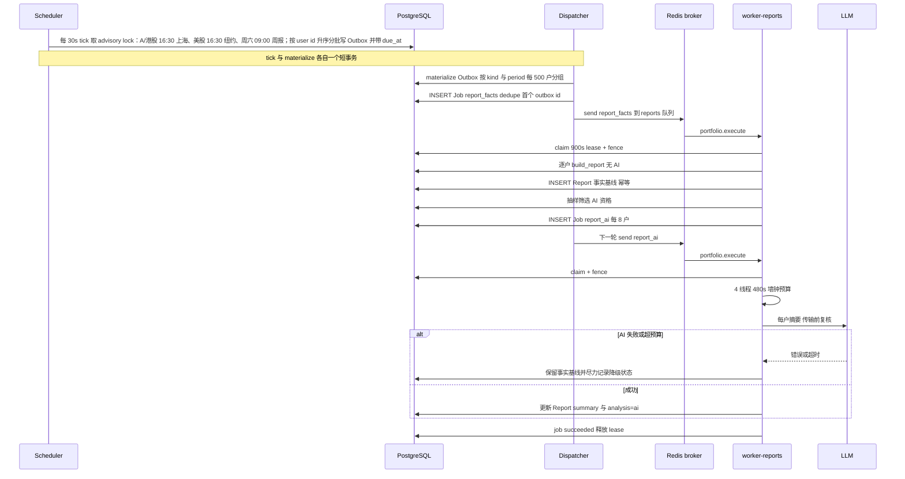
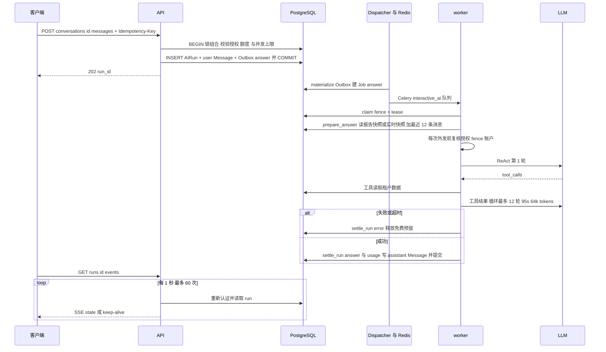
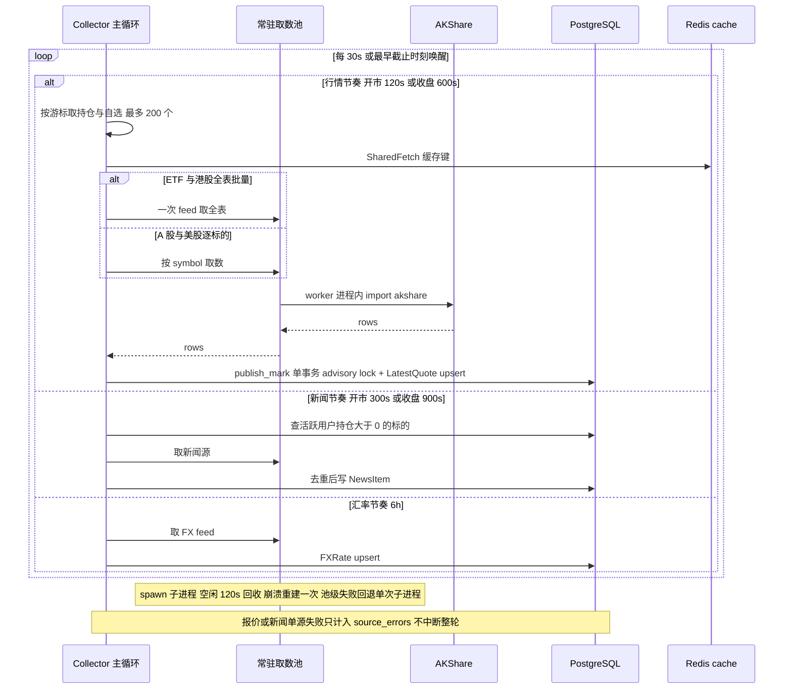
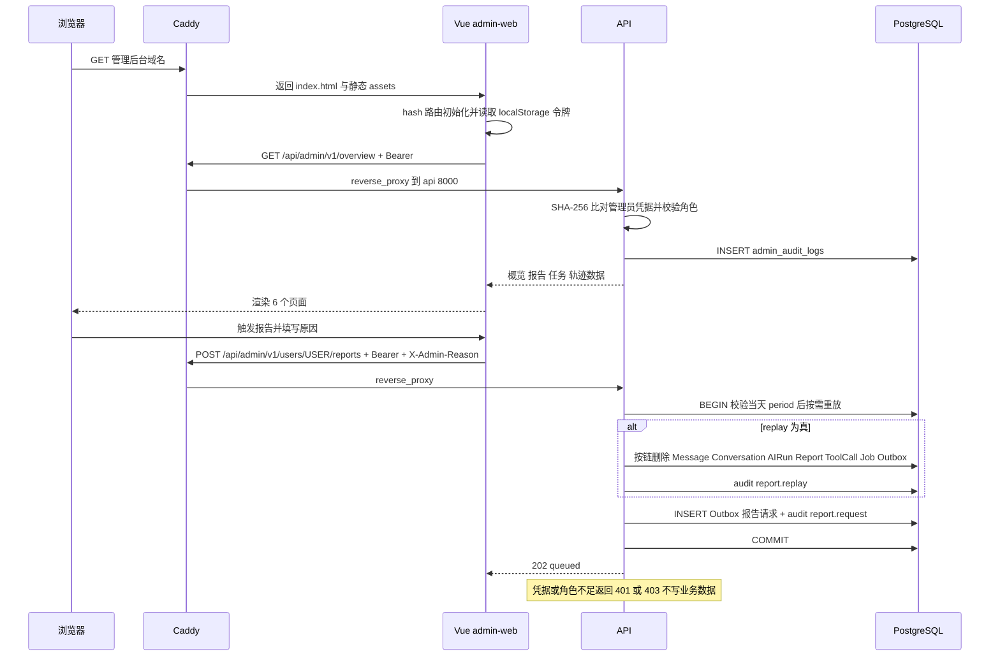
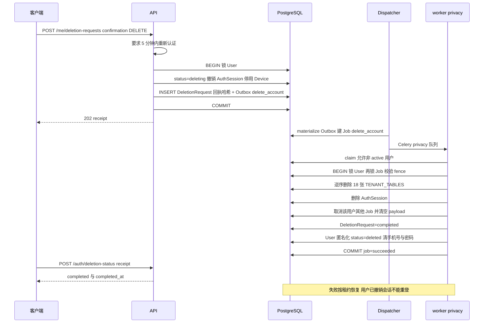

# 运行时序图

> 依据 2026-11-07 当前工作区代码整理（含未提交的性能重构改动），只描述已经实现的路径。图中 `->>` 表示同步调用或同进程调用，`-->>` 表示返回或异步结果；`alt/else` 表示分支与降级。PostgreSQL 每个 `with db.tenant(...)` / `with db.control(...)` 块是一个短事务，关键边界在图中标为 `BEGIN` / `COMMIT`。`Outbox -> Job -> Celery` 是跨进程异步边界。行号以写作时为准，代码改动后需同步更新。

## 阅读约定

- **同步边界**：FastAPI 请求内只做校验、事务写入和投递；AI 回答、报告生成、隐私删除都在 Worker。
- **异步边界**：领域事件先写 `outbox_events`，Dispatcher 再物化为 `jobs` 并投递 Celery；Worker 用 `fence` 和 `lease_until` 保证重复投递不重复产生副作用。
- **降级原则**：缺报价或缺汇率不补 0、不补成本；AI 失败保留事实基线；可重试错误按退避重试，不可重试错误终止并释放额度或保留事实报告。

## 1. 手机号登录、会话与刷新轮换

后端提供手机号验证码、本机号码认证和密码登录三条入口；当前产品主路径是本机号码一键登录，短信需显式开通。Apple 身份校验器仍保留在 `services/auth.py`，但 `create_app` 没有挂载 Apple 登录路由，客户端也已移除 Apple 登录入口，因此图中只画当前可用的手机号/本机号码路径。短信登录要求 `PA_ALIYUN_SMS_ENABLED`，本机号码认证要求 `PA_ALIYUN_CARRIER_ENABLED`，测试号登录仅限 Sandbox。`/api/mobile/v1/auth/*` 先经过按 IP 的固定窗口限流；验证码 challenge、限流计数和首次设密证明放在 auth-cache Redis，token 摘要放在 PostgreSQL `auth_sessions`，Redis 不存 token 摘要。

**代码位置**

- `src/portfolio_backend/api.py:170-190`：`/auth/*` 的 IP 固定窗口限流；`src/portfolio_backend/api.py:236-250`：Sandbox 测试号、短信与密码登录入口；`src/portfolio_backend/api.py:285-291`：本机号码登录入口；`src/portfolio_backend/api.py:352-361`：refresh 与 logout。
- `src/portfolio_backend/services/phone_auth.py:195-241`：发送/校验验证码、Lua 限流与一次性消费；`:250-298`：测试号与手机号登录、建号与会话签发；`:300-326`：密码登录；`:440-461`：本机号码 token 防重放。
- `src/portfolio_backend/services/auth.py:60-80`：签发 access/refresh 并写入摘要；`:137-150`：Bearer 认证；`:152-185`：refresh 轮换、重放检测与 family 撤销；`:33-57`：Apple 校验器（当前无路由）。
- `src/portfolio_backend/config.py:73-74`：access 900 秒、refresh 30 天。

**说明**

- 密码登录先在事务外做 scrypt 哈希校验，再在短事务内 `FOR UPDATE` 复核密码未被修改，避免哈希计算期间持有行锁。
- 同一个已撤销 refresh 再次使用会撤销整个 family，随后以 `refresh_reused` 拒绝；这不是只撤销当前一行。
- 注意：token 摘要只在 PostgreSQL `auth_sessions.access_hash` / `refresh_hash`；auth-cache 只存限流、验证码和一次性证明，不存 token 摘要。

## 2. 首页加载

`GET /api/mobile/v1/home` 在一个只读租户事务内完成五项读取：组合快照、资产历史、最新报告、新闻。快照对 `portfolios` 行取 `FOR SHARE`，持仓与标的连接后左连接 `latest_quotes`，再读全表 `fx_rates`。只有 `current` 与 `close_mark` 计入市值合计；`nav` 计入覆盖但不并入盘中市值合计；缺失报价、来源不匹配、过期、缺汇率都写入 `missing`，不会用成本或 0 填补。

收盘标记放宽：当市场按本地时区处于非交易时段（无节假日日历，节假日按休市处理），来源日在参考日 0 到 `PA_CLOSE_MARK_MAX_AGE_DAYS` 天内的过期实时/延迟报价可标为 `close_mark`，保留真实时间戳，绝不改标为实时；`nav` 不参与该放宽。配置为 0 时，首页/实时快照关闭该放宽。报告快照除此以外还保留同日 `report_state` 口径，并在报告日与来源日之间的跨日窗口内同样允许 `close_mark`（例如周六的报告使用周五收盘），窗口仍受 `PA_CLOSE_MARK_MAX_AGE_DAYS` 限制。

首页盈亏口径（均以人民币计）：

- `daily_pnl_cny`：当前完整估值合计减去最近一条完整日报的市值；当前不完整或没有日报时为 `null`。
- `yesterday_pnl_cny`：最近两条完整日报市值之差；不足两条日报时为 `null`。
- `cumulative_pnl_cny`：按 `current` / `close_mark` 口径的未实现盈亏，加上各币种已实现盈亏按有效汇率折算后的金额；组合不完整、无持仓或任一已实现币种缺有效汇率时为 `null`。

`asset_history` 只取最近 90 条 `complete=true` 的日报快照并按时间去重排序。首页在快照完整且 `asset_history` 的最后一点不是今天时，会把当前快照作为「今日点」追加到图表末尾；这个点只用于展示，不写回 `reports`。

**代码位置**

- `src/portfolio_backend/api.py:669-686`：`_close_marks()` 配置开关与 `/portfolio/snapshot`、`/positions`；`src/portfolio_backend/api.py:705-735`：`/home` 的查询、今日点追加和响应组装；`src/portfolio_backend/api.py:1654-1665`：`report_view`。
- `src/portfolio_backend/services/portfolio.py:31`：收盘标记最大天数常量；`:34-63`：按市场判断交易时段；`:66-79`：`close_mark_state`；`:82-105`：`recent_complete_daily_values`；`:122-151`：`quote_status` 与同日 `report_state`；`:381-535`：`snapshot` 的估值与 PnL；`:537-560`：`asset_history`。
- `src/portfolio_backend/models.py:120-142`：`LatestQuote` 与 `FXRate`；`:231-245`：`Report`。
- `src/portfolio_backend/services/news.py`：`for_user` 的持仓过滤。
- `src/portfolio_backend/config.py:61-62`：`PA_CLOSE_MARK_MAX_AGE_DAYS`，默认 4，0 关闭。

**说明**

- 快照读取的是当前 `Portfolio` 行版本，但不会锁持仓行；写入路径（开仓、交易、分类修改）会 `FOR UPDATE` 组合行来串行化版本。
- `close_mark` 的展示值是真实来源价，不是收盘价重算；`as_of` 保持原始时间，客户端应继续显示「收盘/延迟」状态。
- `daily_pnl_cny` 依赖最近一条完整日报；当天首次打开且当天日报尚未生成时通常为 `null`，这是当前实现的明确降级，不是 0 收益。

## 3. 持仓录入与交易

开仓与买卖都走 `db.tenant` 单事务：先做幂等键检查，再锁组合行，随后改 `positions`、写 `ledger_events`、递增组合版本并写 `portfolio_changed` Outbox。开仓价为空且现有报价不是 `current` / `nav` 时，会在用户事务之外尝试一次共享行情刷新；刷新失败且没有可用报价时返回 `cost_quote_unavailable`，要求客户端手动填写成本，不会在事务内做慢速外呼。

实际 HTTP 状态是 **201**（不是 202）：账本和幂等响应在同一个数据库事务内落地后才返回。`portfolio_changed` Outbox 目前没有对应的 Job 消费者：Dispatcher 只把它标记为已投递，因为所有读取都直接查权威数据库，不需要缓存失效任务。

**代码位置**

- `src/portfolio_backend/api.py:458-500`：开仓入口、事务外行情刷新与 `refreshed_after`；`src/portfolio_backend/api.py:503-506`：买卖入口。
- `src/portfolio_backend/services/portfolio.py:233-336`：`open_position`；`:329-378`：`trade`；`:214-228`：`position_view`。
- `src/portfolio_backend/services/common.py:11-14`：`lock_portfolio` 的 `FOR UPDATE`；`:24-52`：`idempotent` 的 advisory lock、请求摘要与响应复用。
- `src/portfolio_backend/services/jobs.py:52-68`：`portfolio_changed` 只标记 `dispatched_at`，不创建 Job。
- `src/portfolio_backend/models.py:409-415`：`Outbox` 的 `dedupe_key` 唯一约束；`:172-209`：`Position` 与 `LedgerEvent` 的版本、唯一性和金额约束。

**说明**

- 同一幂等键配不同请求体会返回 `idempotency_conflict`；同一键配同一请求体直接返回已保存响应，不会二次写账。
- 省略 `account_id` 时在组合锁内复用最早的账户；没有账户则创建「默认持仓」账户，已有账户和账本历史不会被删除。
- 交易要求 `expected_version` 匹配，否则 `version_conflict`；买卖日期不能早于最近记录或晚于当前时间。
- 开仓只校验标的可录入（存在、启用、展示权确认），报价可缺失；但自动估算成本需要 `current`、`nav` 或刷新后的 `stale` 报价，否则 `cost_quote_unavailable`。

## 4. 日报/周报生成（方案 A 两阶段）

Scheduler 每 30 秒跑一次 `tick`，用固定 advisory lock 防止多副本重复调度。定时会话固定为三个：`daily_cn`（A/港股收盘后 16:30 Asia/Shanghai）、`daily_us`（美股收盘后 16:30 America/New_York）与 `weekly`（每周六 09:00 Asia/Shanghai）。窗口到达后按 `Preferences.user_id` 升序分批次写 Outbox：每 `PA_REPORT_DISPATCH_BATCH_USERS`（默认 50）户延迟 `PA_REPORT_DISPATCH_BATCH_INTERVAL_SECONDS`（默认 15s），因此 id 越大的用户投递越晚；`due_at` 写在 Outbox payload 里，Dispatcher 只会 materialise 已到期的行。Outbox 的 `dedupe_key` 是 `report:{user}:{kind}:{period}`，所以同一天重复 tick 不会重复生成。

Dispatcher 把日报/周报 Outbox 按 `kind + period` 分组，每 500 户切成一个 `report_facts` 批量 Job；每个 Outbox 仍在同一事务标记 `dispatched_at`，批量 Job 用首个 Outbox id 去重。`report_facts` 在 `worker-reports` 中逐户生成无 AI 的事实基线并写 `Report`，然后按抽样比例筛选 AI 资格，每 8 户生成一个 `report_ai` Job。下一轮 Dispatcher 把这些 Job 投到同一个 `reports` 队列。

`report_ai` 在单个任务内用 4 个线程并发、最多 480 秒墙钟预算；每个用户调用前复核 fence、账户和 AI 授权，任一用户失败只把该用户降级为事实基线，不拖垮整个批次；预算耗尽则取消未完成的 future，已写入的事实报告保留。只有 fence 失效会重新抛出并让整个批次失败，由新 fence 的 Worker 接手；其他错误按用户降级。`report_facts` / `report_ai` 租约默认 900 秒，Celery visibility_timeout 提到 1200 秒，软/硬时限按预算加 90/120 秒。

**代码位置**

- `src/portfolio_backend/scheduler.py:14-63`：advisory lock、18 点判断、周报星期天、Outbox 去重；`:66-81`：30 秒主循环与 trace 清理。
- `src/portfolio_backend/services/jobs.py:11-26`：队列映射与批量租约；`:35-86`：Outbox 物化、500 户分组、批量去重；`:89-110`：先投递后标记；`:113-145`：claim、fence 与租约校验。
- `src/portfolio_backend/worker.py:154-176`：`build_report` 事实基线；`:223-237`：`_ai_eligible` 抽样；`:239-302`：`report_facts`；`:305-331`：`_enqueue_report_ai`；`:334-359`：AI 结果落库与授权撤销降级；`:362-388`：单用户 AI 摘要；`:391-436`：`report_ai` 线程池、预算与逐用户降级。
- `src/portfolio_backend/worker.py:581-606`：报告批次软/硬时限与 Dispatcher 投递；`src/portfolio_backend/config.py:92-100`：批量大小、并发、预算、租约与抽样配置。

**说明**

- 旧的逐用户 `daily` / `weekly` 任务仍保留在 `QUEUES` 中，走 `reports` 队列；新调度统一走 `report_facts` + `report_ai` 两阶段。
- 事实阶段不调用模型，但会读取 `PA_REPORT_AI_SAMPLE_RATIO`（默认 1.0）和 `PA_REPORT_AI_REQUIRE_SUBSCRIPTION` 来筛选 AI 候选；AI 阶段只对已入队的用户生成摘要。
- 事实报告写入后，AI 只更新同一行 `Report` 的 `summary` 和 `snapshot.analysis`；AI 失败或授权撤销时 `analysis.kind` 回到 `facts`，摘要仍可读。

## 5. Ask Agent 追问

提问接口只做额度、授权、并发校验和入队：在一个 `db.tenant` 事务内锁组合、校验 AI 服务配置、`interactive_ai` 授权、报告免费追问额度、同用户最多 2 个运行中任务、同会话最多 1 个运行中任务，然后写 `AIRun`、用户 `Message` 和 `answer` Outbox，返回 202。报告追问必须走 `/reports/{id}/questions`；普通会话追问不再有订阅限制，只有并发上限与免费额度。

Dispatcher 把 `answer` Outbox 物化为 `answer` Job，投到 `interactive_ai` 队列，由独立 `worker` 执行。`prepare_answer` 读取报告快照或实时组合快照，只带最近 12 条消息；随后在每次外发前复核 consent、fence 和账户状态。ReAct 循环最多 12 轮、95 秒、64k token 会话预算；每轮模型调用和每次工具调用都重新执行 `before_transmission`，工具超时 15 秒、单轮最多 16 个工具、同一调用达到上限即停止（默认第 3 次触发）、单个结果最多 12000 字符。成功或失败都在最后的短事务里 `settle_run`，释放或消费免费追问预留额度。

客户端通过 `GET /runs/{id}/events` 读取 SSE：每秒轮询一次，最多 60 次；每次轮询都重新认证并读取运行状态，状态变化时发 `state` 事件，无变化时发 keep-alive，遇到 `succeeded` / `failed` 或断连即结束。轮询睡眠期间不持有数据库连接。

**代码位置**

- `src/portfolio_backend/api.py:906-916`：提问入口；`:934-962`：SSE 每秒轮询、重新认证与断开处理；`:777-785`：报告追问入口。
- `src/portfolio_backend/services/ai.py:55-136`：额度、并发、会话与 Outbox 入队；`:139-160`：`settle_run` 的免费额度结算。
- `src/portfolio_backend/worker.py:111-121`：`before_transmission`；`:128-151`：`prepare_answer` 与 12 条历史；`:460-571`：`execute` 的 claim、ReAct 调用和最终事务。
- `src/portfolio_backend/agent/runtime.py:16-74`：95 秒截止、系统提示、快照与历史组装、递归上限；`src/portfolio_backend/agent/graph.py:43-136`：轮数/时间/token 预算与每轮 consent 复核；`:138-251`：工具白名单、只读守卫、超时、重复调用与结果截断。
- `src/portfolio_backend/config.py:40-46`：12 轮、95 秒、64k token、工具超时等默认值。

**说明**

- API 只写 `AIRun` 和用户消息，不等待模型；Worker 成功后才写 assistant 消息，失败时 `AIRun.status=failed` 且 `error_code` 可读。
- 免费追问在入队时 `free_reserved += 1`，成功后转 `free_used`，失败释放；所有用户都保留并发上限。
- 工具循环中同一调用达到 `PA_AGENT_IDENTICAL_CALL_LIMIT` 次即停止（默认 3 次触发，前两次可执行）；`interactive_ai` 与 `reports` 分属两个 Worker 进程池，18 点报告洪峰不会阻塞问答。

## 6. 行情采集

Collector 主循环不是一个固定 30 秒 tick，而是行情、新闻、汇率三条独立节奏：行情开市 120 秒、收盘 600 秒；新闻开市 300 秒、收盘 900 秒；汇率固定 6 小时。循环每次睡到最早的下一截止时间，最多睡 30 秒，以便处理目录同步请求。`--once` 仍然只跑一轮。

行情 tick 只采集「有正持仓或自选」的标的，按 `Instrument.id` 稳定游标分批，单 tick 最多 `PA_DATA_MAX_INSTRUMENTS_PER_TICK`（默认 200）。ETF 与港股现货是全表批量源，缓存键按 provider 而不是单标的；A 股个股与美股按 symbol 逐标的。所有取数走常驻子进程池：spawn 启动，akshare 只在 worker 进程内 import，空闲 120 秒回收；池基础设施失败（子进程崩溃等 `BrokenProcessPool`）会重建并重试一次，仍失败则回退单次子进程。普通取数超时在重试后返回 `market_source_unavailable`，不会无限重发；只有池级失败才走单次子进程兜底。

新闻只覆盖「活跃用户 + 正持仓」的标的，与自选无关；汇率用 Redis `SET NX EX` 做 6 小时节流，失败保留上一次汇率。生产环境发布报价前还会校验商业展示权确认。

**代码位置**

- `src/portfolio_backend/collector.py:34-46`：开市/收盘的有效轮询间隔；`:49-76`：`publish_mark` 的 advisory lock、kind 校验和 upsert；`:79-105`：汇率节流与 upsert；`:108-162`：行情游标、批量/逐标的与错误计数；`:165-199`：新闻节奏；`:202-266`：三节奏主循环与进程池关闭。
- `src/portfolio_backend/providers/market.py:18-28`：`market_session`；`:89-143`：批量源缓存键与 provider 校验；`:106-137`：池失败回退单次子进程；`:195-251`：报价时间、kind 与 previous NAV 归一化。
- `src/portfolio_backend/providers/market_worker.py:33-42`：spawn 上下文与空闲回收常量；`:53-141`：池创建、重试、崩溃/超时处理；`:158-175`：进程级默认池与 broken 冷却。
- `src/portfolio_backend/providers/akshare_worker.py:17-37`：akshare 懒加载与 `fetch_rows`；`src/portfolio_backend/config.py:59-71`：三节奏、单 tick 配额与取数进程数。

**说明**

- 行情采集失败只增加 `source_errors` 并继续下一个标的，不会中断整轮；同一标的的失败不会阻塞游标推进。
- 收盘时段只对行情与新闻降频，汇率仍按 6 小时节奏；没有节假日日历，节假日按收盘节奏运行。
- `market_session` 只按 Asia/Shanghai 周一至周五 09:30–11:30 / 13:00–15:00 判断 A 股交易时段，与港股、美股本地交易时段无关。

## 7. 管理后台

浏览器访问独立管理域名，Caddy 托管 Vue 3 构建产物并只把 `/api/admin/v1/*` 反代到 API。前端使用 hash 路由，共 5 页：运行概览、报告查看、触发报告、任务状态、AI 调用轨迹。管理员令牌保存在浏览器 `localStorage`，请求拦截器统一附加 `Authorization: Bearer`；写操作还要求 `X-Admin-Reason`（5–500 字）。

API 侧 `operator` 用 SHA-256 摘要与 `PA_ADMIN_CREDENTIALS` 做常量时间比较，角色限定为 owner / operations / support；每个管理端点都会写 `admin_audit_logs`，GET 用固定原因，写操作使用请求头原因。报告触发只允许「当天」的 period，`replay=true` 时先按链删除消息、会话、AI 运行、报告、工具调用、任务和 Outbox，再重新插入 Outbox；随后由普通报告管线异步生成。

**代码位置**

- `admin-web/src/router/index.ts:3-41`：6 个 hash 路由；`admin-web/src/api/http.ts:39-100`：Bearer 拦截器与 `X-Admin-Reason`；`deploy/beta/Caddyfile:15-30`：静态托管与 `/api/admin/v1/*` 反代；`admin-web/README.md` 的「页面与 API 对照」表。
- `src/portfolio_backend/api.py:98-126`：`operator`、角色校验与 `audit`；`:1188-1219`：概览与任务；`:1441-1506`：报告触发与重放；`:1559-1626`：报告列表/详情。
- `src/portfolio_backend/models.py:426-432`：`AuditLog`；`:391-406`：`Job`。

**说明**

- 不是所有管理 GET 都要求 `X-Admin-Reason`；但所有端点都会落审计日志，写操作的原因由 FastAPI Header 校验为必填。
- 报告触发只接受服务器 Asia/Shanghai 时区的当天 period，历史回放返回 `historical_report_unavailable`。重放按单用户 `report:{user}:{kind}:{period}` 查找 Job，而方案 A 的 `report_facts` 批量 Job 使用 `report_facts:{kind}:{period}:{outbox_id}` 键，不在该删除集合内；若批量任务仍在途，重放可能与其交叉，当前代码未做额外串行化。

## 8. 账户删除（隐私）

删除入口不是 HTTP `DELETE`，而是 `POST /api/mobile/v1/me/deletion-requests`，请求体要求 `confirmation=DELETE`，且当前会话必须在 5 分钟内重新认证过。API 在一个 control 事务里锁用户、把状态改为 `deleting`、撤销全部 `AuthSession`、停用设备、写删除回执哈希和 `delete_account` Outbox；事务提交后旧 token 立即失效。

Dispatcher 物化出 `delete_account` Job 投到 `privacy` 队列。Worker 的 claim 允许非 active 用户，因此 `deleting` 用户的任务仍可执行。最终事务按「用户 → 任务 → 私有记录」顺序加锁：先锁 `User`，再锁 `Job` 并校验 fence，然后逆序删除 `TENANT_TABLES`、删除 `AuthSession`、取消该用户其他 Job 并清空 payload、把 `DeletionRequest` 置为 completed、把 `User` 匿名化为 `deleted:{id}` 并清空手机号和密码。审计日志和删除回执不属于租户表，保留用于对账、审计和回执查询。

**代码位置**

- `src/portfolio_backend/api.py:1142-1175`：删除申请、5 分钟重新认证、状态置 `deleting`、撤销会话、写回执与 Outbox；`:1177-1186`：按回执查询删除状态。
- `src/portfolio_backend/services/jobs.py:11-21`：`delete_account` 映射到 `privacy` 队列；`:113-132`：claim 时允许非 active 用户。
- `src/portfolio_backend/worker.py:442-458`：`erase_private_data` 的删除顺序；`:460-571`：`execute` 的最终事务与 `delete_account` 分支。
- `src/portfolio_backend/models.py:435-444`：`TENANT_TABLES`，当前 18 张表。
- `tests/test_auth_privacy.py:62-90`：删除后立即 401、租户表清空、`AuthSession` 清空、用户匿名化与回执 completed 的自动化证据。

**说明**

- `TENANT_TABLES` 由所有继承 `Tenant` 的模型自动推导；新增租户表只要继承 `Tenant`，删除时会自动包含，但外部存储（对象存储、缓存、第三方）仍需单独添加擦除步骤。
- `SubscriptionTransaction`、`SubscriptionEvent`、`AuditLog`、`DeletionRequest` 不属于租户表，当前保留；如需删除购买恢复能力，必须另行设计。
- API 事务先撤销会话再投递异步删除，用户感知是「立即退出、后台清理」；Worker 失败时任务可按租约恢复，已经置 `deleting` 的用户不会重新登录。

## 如何维护

新增模块或改动既有流程时，按以下步骤更新本文件，避免文档与代码漂移：

1. **先读代码再画图**：以 `src/portfolio_backend/` 的实际入口、事务边界和队列映射为准；不要根据需求描述补画未实现的路由、状态码或字段。
2. **一章一图**：每个主流程新增一个 `sequenceDiagram`，保持 30 行以内；参与者至少覆盖客户端、API、PostgreSQL、Redis/Celery 中的相关方，以及外部数据源或模型。
3. **标清三类边界**：同步/异步（`->>` 与 `-->>`、Outbox/Celery）、事务（`BEGIN`/`COMMIT`、`db.tenant`/`db.control`、行锁或 advisory lock）、失败降级（`alt/else`、重试、事实基线、额度释放）。
4. **同步「代码位置」**：每图下方列出 `文件:行号`；修改函数、队列名、配置默认值或状态码时，同一提交内更新引用。行号漂移时优先修正为函数名加行号。
5. **同步链接与状态**：新增文档后更新 `README.md` 的文档入口；流程仍未实现的，写「未实现」或「当前无路由」，不要画成已运行路径。
6. **提交前检查**：至少渲染一次 Mermaid（GitHub、VS Code 或 Mermaid Live），确认没有未闭合的 `alt/loop`、消息中没有 ASCII `;`、图中无原始 HTML 或未转义的特殊字符。
